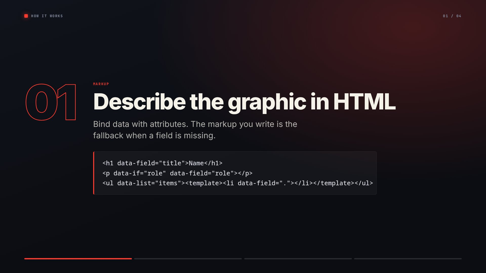
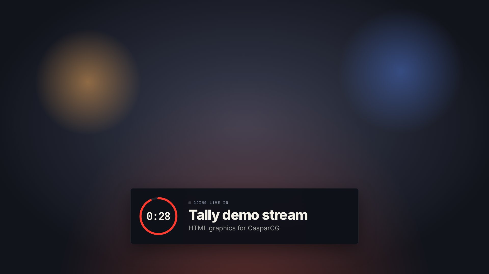
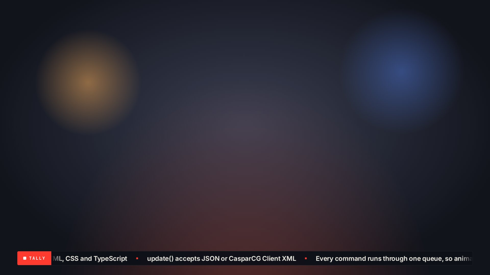
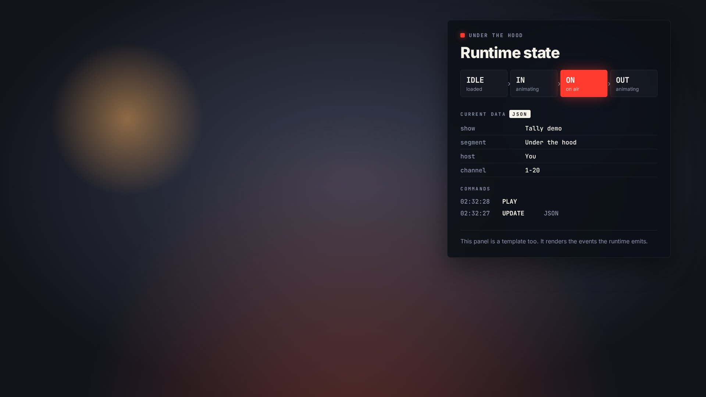

# Tally

A small framework for building HTML graphics templates for [CasparCG](https://casparcg.com).
Write a template in plain HTML, CSS and TypeScript, preview it in a dev harness, and build it into a single self-contained `.html` file that you drop into CasparCG's template folder.

| | |
|---|---|
|  |  |
|  |  |
|  |  |

Requires CasparCG Server 2.4 or newer (CEF 117+) and Node.js 22.18+ for development.

## Quick start

```bash
npm install
npm run dev          # dev harness at http://localhost:5173
npm run build        # dist/<template>.html, one file per template
```

Copy the files in `dist/` into CasparCG's `template` folder (or build straight into it with `npm run build -- --out /path/to/casparcg/template`), then:

```
CG 1-20 ADD 1 "lower-third" 1 "{\"title\":\"Hello\",\"subtitle\":\"From CasparCG\"}"
CG 1-20 NEXT 1
CG 1-20 STOP 1
```

`npm run cg` sends the same commands from the terminal:

```bash
npm run cg -- add lower-third sample:0     # first sample from templates/lower-third/preview.json
npm run cg -- invoke "flash('Replay')" --host 10.0.0.5
```

## Demo templates

Each demo shows off a different part of the framework.

| Template | Shows |
|---|---|
| `lower-third` | A name strap. Several steps fit in one payload and NEXT plays the next one. An on-air UPDATE rolls the text over in place. The style payload changes the accent colour and the position. |
| `bug` | A corner bug with a live clock. Actions (`onAir`, `offAir`, `flash('Replay', 3)`) change it through `CG INVOKE`. |
| `ticker` | A seamless crawl built with `data-list`. A custom `update` hook swaps headlines while it stays on air. |
| `title-card` | A full-frame explainer. A custom `next` hook swaps only the content; a `back` action steps backwards. |
| `scoreboard` | Nested fields (`home.score`), colours from data via `data-var-*`, and update animations on only the digits that changed. |
| `countdown` | A timer that runs inside the template, with `start`, `pause`, `add(30)` and `restart` actions. |
| `inspector` | A template that draws the runtime it runs on: state machine, current data and command log, live. |

## Writing a template

```bash
npm run new -- my-graphic
```

This creates `templates/my-graphic/` with four files:

- `index.html`: the markup, with data bindings.
- `style.scss`: the styles. Plain CSS works as well.
- `main.ts`: calls `defineGraphic()` with the animations and actions.
- `preview.json`: sample data and actions for the dev harness. It is not part of the build.

A complete template:

```html
<!-- index.html -->
<div class="graphic" data-graphic>
	<h1 data-field="title">Title</h1>
	<p data-field="subtitle" data-if="subtitle"></p>
</div>
<script type="module" src="./main.ts"></script>
```

```ts
// main.ts
import "tally/base.css";
import "./style.scss";
import { gsap } from "gsap";
import { defineGraphic } from "tally";

defineGraphic<{ title: string; subtitle?: string }>({
	fields: { title: { required: true }, subtitle: {} },
	in: ({ root }) => gsap.from(root, { x: -40, opacity: 0 }),
	out: ({ root }) => gsap.to(root, { x: -40, opacity: 0 }),
});
```

### Binding data

Bindings are attributes. The markup's own content is the fallback when a field is missing.

| Attribute | Effect |
|---|---|
| `data-field="home.score"` | Sets the text content. Dotted paths reach into nested data. |
| `data-attr-src="logo"` | Sets any attribute (here `src`). |
| `data-var-team="home.color"` | Sets a CSS custom property on the element (here `--team`). |
| `data-if="subtitle"` | Hides the element unless the value is truthy (`""` and `"false"` count as false). `data-if="!subtitle"` negates. |
| `data-list="items"` | Repeats the element's `<template>` child once per item. Inside, `.` is the item itself and `$index` / `$number` give its position. |

Use `data-field` only on leaf elements, because it replaces everything inside the element.

### `defineGraphic(definition)`

| Option | |
|---|---|
| `root` | The element that holds the graphic. Defaults to `[data-graphic]`, then `<body>`. |
| `fields` | `{ name: { label, type, default, required } }`. Defaults fill missing data. `play` refuses to run while a required field is empty. |
| `style` | Default style values (see Styling). |
| `loop` | Makes `next()` wrap from the last step back to the first. |
| `setup(ctx)` | Runs once on load. |
| `in(ctx)`, `out(ctx)` | Return a promise or a GSAP timeline. The runtime waits for it to finish. |
| `next(ctx)` | Replaces the default step change (out, next step, in). |
| `update(ctx, previous)` | Runs when data arrives while on air. Defaults to `ctx.render()`. |
| `actions` | `{ name(ctx, ...args) }`. Each one is exposed as a global, so `CG INVOKE 1 "name(1, 'x')"` calls it. |

`ctx` gives you:

- the state: `root`, `data` (the current step merged over the defaults), `steps`, `step`, `style` and `state`;
- the helpers `$(selector)` and `$$(selector)`, scoped to the root;
- `render(data?)`, which returns the elements whose content changed;
- `setData(patch)`, `goTo(step)` and `log(...)`.

### Commands

| AMCP | Template | Behaviour |
|---|---|---|
| `CG ADD … 1 "<data>"` | `update(data)` then `play()` | Loads the data and animates in. |
| `CG UPDATE "<data>"` | `update(data)` | Replaces the data. On air, runs the `update` hook. |
| `CG PLAY` | `play()` | Animates in. |
| `CG NEXT` | `next()` | Plays when idle; otherwise moves to the next step. |
| `CG STOP` | `stop()` | Animates out. The graphic can be played again. |
| `CG REMOVE` | `remove()` | Animates out and returns to the first step. |
| `CG INVOKE "name(args)"` | `name(args)` | Runs an action. There is also a built-in `reset()`, which returns to the first step. |

All commands go through one queue, so a NEXT that arrives mid-animation waits for the animation to finish instead of overlapping it. The state goes `idle → in → on → out → idle`, and the root element carries `data-tally-state` and `data-step` attributes. Errors are logged with a `[tally]` prefix and never stop the queue.

### Data formats

`update()` accepts JSON or the XML the official CasparCG Client sends:

```jsonc
{"title": "…"}                              // one step
[{"title": "…"}, {"title": "…"}]            // several steps, used by NEXT
{"data": [ … ], "style": {"accent": "…"}}   // explicit envelope
{"style": {"accent": "…"}}                  // style only
```

```xml
<templateData>
  <componentData id="title"><data id="text" value="…"/></componentData>
  <componentData id="home.score"><data id="text" value="3"/></componentData>
</templateData>
```

In XML, dotted ids nest (`home.score`) and numeric segments build lists (`items.0`, or `0.title` for steps). XML values always arrive as strings, so convert numbers with `Number()`.

### Styling

- `tally/base.css` sets `1rem` to 16px on a 1920-wide channel and scales it with the channel resolution, so you can lay out in `rem` as if designing at 1080p.
- `--safe-x` / `--safe-y` (5%) and `--action-safe-x` / `--action-safe-y` (3.5%) follow EBU R 95.
- Style values become CSS custom properties on the root: `{"style": {"primaryColor": "red"}}` sets `--primary-color`.
- Each style value is also set as an attribute on the root, so `[data-style-position="center"]` works as a CSS selector.
- The root is `visibility: hidden` while idle.
- Don't use GSAP's `clearProps: "all"` on the root, because it also removes these custom properties.

## Dev harness

`npm run dev` opens a control room for every template in `templates/`:

- a scaled 1920×1080 stage with safe-area guides and several backgrounds;
- ADD / PLAY / NEXT / STOP / REMOVE / UPDATE buttons (keyboard shortcuts `A P N S R U`), called the same way CasparCG calls them;
- a data editor with the samples from `preview.json`, sent as JSON or converted to CasparCG Client XML;
- the matching AMCP line, ready to copy;
- action buttons, a free-form invoke box, and a log of commands, state changes and errors.

## Tests

```bash
npm test             # unit tests: parsing, binding, the state machine
npm run check        # builds, then loads every dist/*.html over file:// in Chromium and drives it like CasparCG
npm run screens      # same as check, and refreshes docs/screens/
npm run typecheck
```

`npm run check` needs Playwright's Chromium. Install it once with `npx playwright install chromium` if you don't have it yet.

## Coming from the concept engine

| Concept engine | Tally |
|---|---|
| Content was matched by element `id`. | Content is bound with `data-field`, which is scoped to the graphic and supports nested paths. |
| `data-style-primaryColor="stroke"` styled single elements. | Styles are CSS variables: use `stroke: var(--primary-color)` in CSS. |
| `update()` appended to the data. | `update()` replaces the data. Send an array for several steps. |
| `stop()` could overlap a running `next()`. | Every command is queued. |
| Pages loaded `/css` and `/js` with absolute paths, which break over `file://`. | Each build is one file with nothing to resolve. |
| Sample data was hard-coded in the template. | Sample data lives in `preview.json`, which is used by the harness only. |
